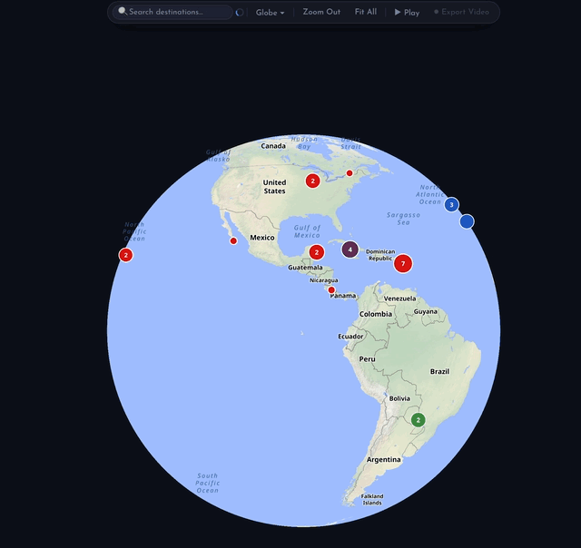
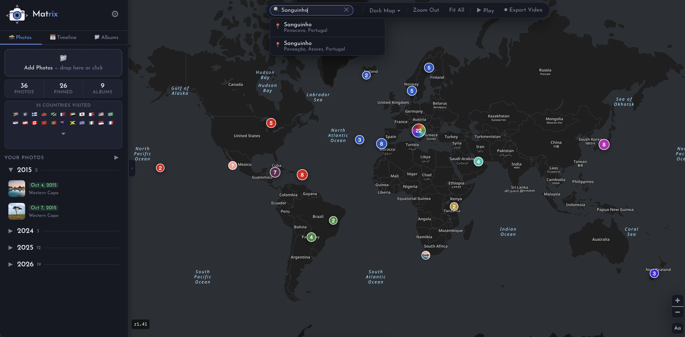
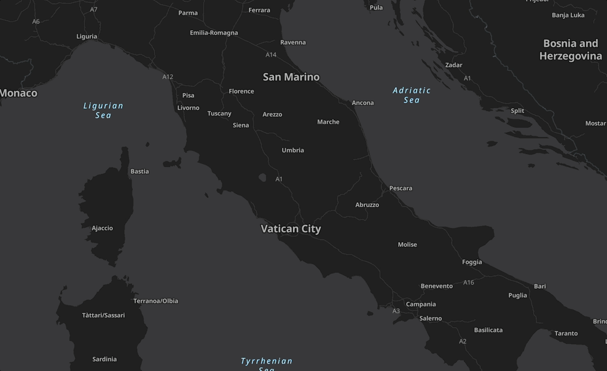
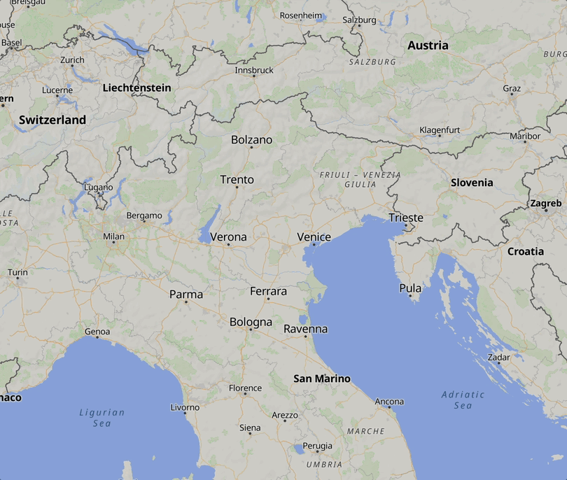

# Matrix

*A local-first travel photo mapping app. Runs entirely in your browser, no account needed.*

Add photos with GPS data and Matrix pins them on a map, with albums, a timeline and offline browsing. A small local Python server serves the app and keeps a backup of your data on disk.

## Quick Start

1. **Download** the repository (git clone it).

2. **Launch the server** (requires Python 3):
   ```bash
   python3 serve.py
   ```
   or
   ```bash
   ./start.command
   ```
   On first run, `serve.py` downloads vendor dependencies into `vendor/`.
   Your browser will open automatically at **http://localhost:8765**

3. **Add photos**: drag & drop JPEG/HEIC files (with GPS data) onto the upload zone.

To keep the server running in the background on macOS, see [Background service](docs/background-service.md).

## Screenshots



<details>
<summary>Interface</summary>


</details>

<details>
<summary>Dark Map Interaction</summary>


</details>

<details>
<summary>Pin a Location</summary>


</details>

[](https://www.youtube.com/watch?v=w9MhBRoiUho)

## Documentation

Full documentation lives in the [`docs/`](docs/) folder:

| Page | What it covers |
| --- | --- |
| [Architecture](docs/architecture.md) | Map stack and how the app is put together |
| [Data persistence](docs/persistence.md) | How data is saved, backed up and migrated |
| [Data storage](docs/data-storage.md) | Storage internals |
| [Tile caching](docs/tile-caching.md) | How map tiles are cached for speed and offline use |
| [Tips and features](docs/tips.md) | Feature overview and usage tips |
| [Keyboard shortcuts](docs/keyboard-shortcuts.md) | Every shortcut |
| [Background service](docs/background-service.md) | Running the server as a macOS LaunchAgent |
| [Synology NAS setup](docs/synology-setup.md) | Running Matrix on a Synology NAS with Tailscale |
| [Demo modes](docs/demo-mode.md) | The built-in automated demos |
| [Testing](docs/testing.md) | Running the Playwright test suite |
| [GitHub workflows](docs/github-workflows.md) | Dependency update and PR summary automation |

## License

This project is licensed under the [MIT](LICENSE) License. See the [LICENSE](LICENSE) file for details.

Built with [Claude Code](https://claude.ai/claude-code)
